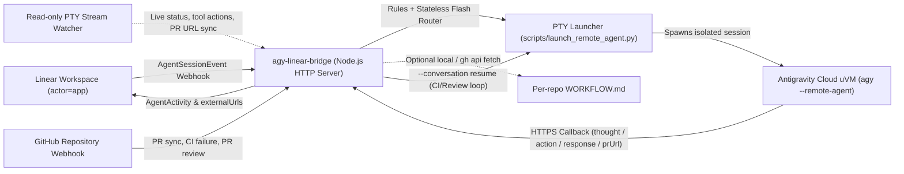

# agy-linear-bridge

English | [简体中文](README.zh-CN.md)

Bridge Linear native **Agent Sessions** (`@mention` or issue assignment with `actor=app`) directly to isolated **Antigravity Remote Agents** (`agy --remote-agent`) running in cloud ACE uVMs.

> [!NOTE]
> **Unofficial Community Bridge**: `agy-linear-bridge` is an independent integration built on Linear's `AgentSessionEvent` webhook/GraphQL API and the `agy` CLI (tested with `agy 1.5.14`, Node.js `v24.22.1`, Python `3.13.11`). Because `agy` headless remote triggers rely on PTY automation and TUI stream parsing, future upstream CLI UI changes may require minor regex updates.

---

## Architecture



---

## Why Use This

- **Zero npm runtime dependencies**: Built purely on Node.js `>= 22` built-in modules and the Python 3 standard library.
- **Zero local Git worktrees**: Work executes in Antigravity cloud ACE uVMs instead of cloning/cleaning multi-repo worktrees locally.
- **Native Linear Agent identity (`actor=app`)**: Satisfies Linear's 5-second webhook ACK and 10-second initial `thought` activity rules out of the box.
- **Hybrid multi-project routing**: Deterministic matching first (`projectId` → `projectSlug` → `projectName` → `labels` → unambiguous `teamKey`), optional stateless `agy -p` Flash fallback, or `elicitation` follow-up when ambiguous.
- **Linear native prompt & branch conventions**: Forwards Linear's `Suggested branch name`, `guidance`, `parent` issue, and `promptContext` without duplicate description bloat so GitHub PRs auto-link cleanly back to Linear.
- **Per-repo `WORKFLOW.md` policy-as-code**: Automatically loads `WORKFLOW.md` from a local checkout or via `gh api` (with TTL caching) to inject repo rules and override `mode`, `ciAutoFix`, `reviewAutoResume`, and `maxCiFixRounds`.
- **Two-way live progress & cancellation**: Combines signed per-session HTTPS callbacks with a read-only PTY stream watcher (`watch_remote_agent.py`), handles Linear `stop` signals (`cancel_remote_agent.py` + `409` callback lockout), and attaches PR URLs to `externalUrls`.
- **GitHub CI & Review closed loop (`POST /webhooks/github`)**: Automatically resumes the same cloud `--conversation` on CI failures or non-bot PR review feedback with `head_sha` deduplication and configurable round circuit breakers.

---

## Quick Start

### Prerequisites

- **Node.js `>= 22.0.0`**
- **Python `>= 3.10`**
- **`agy` CLI** signed in and initialized (`agy --remote-agent` working interactively)
- **GitHub CLI (`gh`)** authenticated (optional, used to fetch `WORKFLOW.md` from private GitHub repositories)
- **`cloudflared`** (or another HTTPS tunnel exposing `127.0.0.1:8787` to Linear and GitHub)

### 1. Configure Remote Project Routing

Copy the example config and fill in your own Linear project IDs/slugs and Antigravity Remote Project UUIDs/names:

```bash
cp config/projects.example.json config/projects.json
```

Start an interactive `agy --remote-agent` session and run `/projects` to inspect your available Remote Project names and UUIDs (use `scripts/provision_remote_projects.py` if you want to batch-create Antigravity Remote Projects from GitHub repos).

> **Tip**: In `agy --remote-agent`, run `/config` and verify that **Permission Preset** and **Plan Review Policy** match your unattended automation preference.

### 2. Start a Public HTTPS Tunnel

- **Quick Tunnel (fastest for local testing)**:
  ```bash
  cloudflared tunnel --no-autoupdate --config /dev/null --url http://127.0.0.1:8787
  ```
- **Named Tunnel (recommended for a custom domain)**:
  ```bash
  bash scripts/setup-tunnel.sh bridge.example.com
  cloudflared tunnel --config ./cloudflared.yml run
  ```

### 3. Start the Bridge & Install Linear App (`actor=app`)

```bash
npm start
```

In a second terminal, run the guided setup wizard:

```bash
npm run setup:linear
```

The wizard writes `PUBLIC_BASE_URL`, `LINEAR_CLIENT_ID`, `LINEAR_CLIENT_SECRET`, and `LINEAR_WEBHOOK_SECRET` to `.env` (`0600`). Restart `npm start`, complete the browser OAuth flow, and the script will automatically verify `viewer.app === true`.

### 4. Optional: Enable GitHub CI & Review Loop

1. Set `GITHUB_WEBHOOK_SECRET` in `.env` and restart `npm start` (`/health` will report `"githubWebhookConfigured": true`).
2. Add a GitHub webhook on your repository or organization:
   - **Payload URL**: `https://<your-domain>/webhooks/github`
   - **Content type**: `application/json`
   - **Secret**: matches `GITHUB_WEBHOOK_SECRET`
   - **Events**: `Pull requests`, `Check runs`, `Workflow runs`, `Pull request reviews`, `Pull request review comments`

---

## Per-Repository `WORKFLOW.md`

Place a `WORKFLOW.md` file in the root of any configured repository (optionally customize `workflowPath` or set `localPath` in `config/projects.json`):

```markdown
---
mode: auto
ciAutoFix: true
reviewAutoResume: true
maxCiFixRounds: 3
---

# Agent Workflow Guidelines

1. Use the suggested branch name from Linear when making code edits.
2. Run `pnpm test` and `pnpm typecheck` before opening a Pull Request.
3. Include the Linear issue identifier in the PR title.
```

---

## Environment Variables

See [.env.example](.env.example) for the complete template:

| Variable | Default | Description |
| :--- | :--- | :--- |
| `PORT` / `HOST` | `8787` / `127.0.0.1` | Local HTTP bind address |
| `PUBLIC_BASE_URL` | — | Public HTTPS base URL for OAuth callbacks, webhooks, and agent session callbacks |
| `LINEAR_CLIENT_ID` / `LINEAR_CLIENT_SECRET` / `LINEAR_WEBHOOK_SECRET` | — | Linear OAuth application credentials (`actor=app`) |
| `ROUTER_MODE` | `hybrid` | `hybrid` (rules first, then stateless `agy -p`) or `rules` (deterministic only) |
| `ROUTER_MODEL` | `gemini-3.8-flash-low` | Model passed to stateless fallback router |
| `AGY_REMOTE_MODE` | `accept-edits` | Default `agy --remote-agent --mode` when not overridden by project or `WORKFLOW.md` |
| `WATCHER_ENABLED` | `true` | Enable read-only PTY progress watcher alongside HTTPS callbacks |
| `WORKFLOW_FETCH_ENABLED` | `true` | Enable local / `gh api` fetching of `WORKFLOW.md` (`WORKFLOW_CACHE_TTL_MS=300000`) |
| `GITHUB_WEBHOOK_SECRET` | — | HMAC-SHA256 secret for `POST /webhooks/github` |
| `GITHUB_CI_AUTO_FIX` / `GITHUB_REVIEW_AUTO_RESUME` | `true` | Toggle automatic `--conversation` resume on CI failures or PR reviews |
| `GITHUB_MAX_CI_FIX_ROUNDS` | `3` | Circuit-breaker limit before requesting human clarification via Linear `elicitation` |
| `GITHUB_IGNORED_ACTORS` | — | Comma-separated GitHub logins to ignore in review webhooks (in addition to bots) |

---

## Verification & Debugging

```bash
# Run unit & integration tests (Node built-in test runner)
npm test

# Dry-run issue routing without launching a remote session
npm run route-test -- --team ENG --project backend-app --title "Fix webhook timeout"

# Verify stored Linear actor=app OAuth token
npm run verify-identity

# Check runtime health & active watcher count
curl http://127.0.0.1:8787/health
```

---

## License

[MIT](LICENSE)
