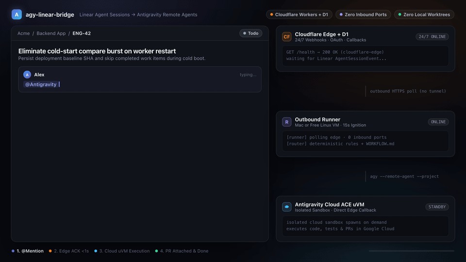
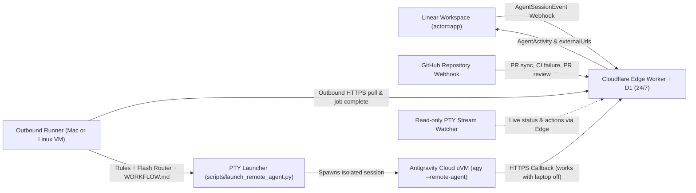

# agy-linear-bridge

Bridge Linear native **Agent Sessions** (`@mention` or issue assignment with `actor=app`) directly to isolated **Antigravity Remote Agents** (`agy --remote-agent`) running in cloud ACE uVMs.

<p align="center">
  
</p>

> [!NOTE]
> **Unofficial Community Bridge**: `agy-linear-bridge` is an independent integration built on Linear's `AgentSessionEvent` webhook/GraphQL API and the `agy` CLI (tested with `agy 1.5.15`, Node.js `v24`, Python `3.13+`). Because `agy` headless remote triggers rely on PTY automation and TUI stream parsing, future upstream CLI UI changes may require minor regex updates.

---

## Architecture



---

## Why Use This

- **24/7 Free-Tier Cloudflare Edge + Zero-Port Outbound Runner (Recommended)**:
  - **Cloudflare Workers + D1** handles Linear/GitHub webhooks, 5s ACK / 10s initial `thought`, OAuth token rotation, and cloud `ACE uVM` callbacks 24/7 on Cloudflare's free tier.
  - **No `cloudflared` tunnel, no inbound ports, no public IP required** on your Runner machine.
  - **Sleep & power-off resilient**: Once a cloud session is ignited (~15s), closing your laptop does not interrupt callbacks, PR attachment, or session completion; issues arriving while your Runner is offline queue safely in D1, or run the lightweight Runner 24/7 on any free Linux VM (e.g. Oracle Cloud Free Tier).
- **Zero npm runtime dependencies**: The Runner and standalone server use only Node.js `>= 22` built-in modules and the Python 3 standard library (`cf` and Vite are devDependencies used only when deploying the Cloudflare Worker).
- **Zero local Git worktrees**: Code changes, builds, and tests run inside Antigravity cloud ACE uVMs — no multi-repo clones or worktree cleanup on your Runner.
- **Native Linear Agent identity (`actor=app`)**: Installs as a real assignable/mentionable Linear Agent and satisfies Linear's 5-second webhook ACK and 10-second initial `thought` rules.
- **Hybrid multi-project routing**: Deterministic matching first (`projectId` → `projectSlug` → `projectName` → `labels` → unambiguous `teamKey`), optional stateless `agy -p` Flash fallback, or `elicitation` clarification when ambiguous.
- **Linear native prompt & branch conventions**: Forwards Linear's `Suggested branch name`, `guidance`, `parent` issue, and `promptContext` without duplicate description bloat so GitHub PRs auto-link cleanly back to Linear.
- **Per-repo `WORKFLOW.md` policy-as-code**: Loads `WORKFLOW.md` from a local checkout or via `gh api` (with TTL caching) to inject repo rules and override `mode`, `ciAutoFix`, `reviewAutoResume`, and `maxCiFixRounds`.
- **Live progress, PR attachment & stop signal**: Streams live cloud tool actions via a read-only PTY watcher (`watch_remote_agent.py`), attaches opened PR URLs to Linear `externalUrls`, and handles Linear `stop` signals (`cancel_remote_agent.py` + `409` callback lockout).
- **GitHub CI & Review closed loop (`POST /webhooks/github`)**: Automatically resumes the same cloud `--conversation` on CI failures or non-bot PR review comments, with `head_sha` deduplication and round circuit breakers.

---

## Deployment Guide

Choose **Option A** (recommended for 24/7 reliability without tunnels) or **Option B** (single-process local server + tunnel).

### Prerequisites

- **Node.js `>= 22.0.0`** and **Python `>= 3.10`**
- **`agy` CLI** installed and signed in on your Runner machine (`curl -fsSL https://antigravity.google/cli/install.sh | bash`)
- **GitHub CLI (`gh`)** authenticated on your Runner machine (`gh auth login`, optional — used to read `WORKFLOW.md` from private GitHub repos)
- **Cloudflare account** (free tier) for Option A, or **`cloudflared`** for Option B

---

### Step 1. Map Your Linear Projects to Antigravity Remote Projects

```bash
git clone https://github.com/anilpixel/agy-linear-bridge.git
cd agy-linear-bridge
cp config/projects.example.json config/projects.json
```

1. Run `agy --remote-agent` interactively and execute `/projects` to view your Antigravity Remote Project names and UUIDs (or batch-create them from GitHub repos with `scripts/provision_remote_projects.py`).
2. Edit `config/projects.json` with each project's `remoteProject` UUID/name, `githubRepo` (`owner/repo`), and Linear matching rules (`projectIds`, `projectSlugs`, `projectNames`, `teamKeys`, or `labels`).
3. In `agy --remote-agent`, check `/config` so **Permission Preset** and **Plan Review Policy** match unattended execution.

---

### Step 2 (Option A, Recommended): Cloudflare Workers + D1 + Outbound Runner

#### 2.1 Choose your public Edge URL & create the Linear OAuth Application

Your Edge URL will be either:
- **Workers subdomain (free, default)**: `https://agy-linear-bridge.<your-workers-subdomain>.workers.dev`
- **Custom Cloudflare domain**: e.g. `https://agy-linear.example.com`

Open **[Linear Settings → API → Applications → New](https://linear.app/settings/api/applications/new)** and create an OAuth app:
1. **Application name**: `Antigravity` (or any name you want to `@mention` in Linear)
2. **Callback URLs**: `<YOUR_EDGE_URL>/oauth/callback`
3. **Webhooks**: toggle **ON**
   - **Webhook URL**: `<YOUR_EDGE_URL>/webhooks/linear`
   - **Webhook events**: check **`Agent session events`**
4. Save the app and copy its **Client ID**, **Client Secret**, and **Webhook Signing Secret**.

#### 2.2 Configure `.env` & deploy Cloudflare Worker + D1

```bash
npm install
npx cf auth login
cp .env.example .env
```

Fill in `.env` on your deploy machine:

```ini
PUBLIC_BASE_URL=https://agy-linear-bridge.<your-subdomain>.workers.dev
EDGE_BASE_URL=https://agy-linear-bridge.<your-subdomain>.workers.dev

LINEAR_CLIENT_ID=<from Linear OAuth App>
LINEAR_CLIENT_SECRET=<from Linear OAuth App>
LINEAR_WEBHOOK_SECRET=<from Linear OAuth App>

# Generate with: openssl rand -hex 32
RUNNER_SHARED_SECRET=<64-char random hex secret>
```

Deploy the Worker and auto-provision the D1 database in one command:

```bash
npm run edge:deploy -- --secrets-file .env
```

> **Using a custom Cloudflare domain instead of `workers.dev`?**
> Export `WORKER_CUSTOM_DOMAIN=agy-linear.example.com` when running `edge:deploy`, then attach the domain trigger:
> ```bash
> WORKER_CUSTOM_DOMAIN=agy-linear.example.com npx cf workers triggers deploy --zone example.com
> ```

#### 2.3 Authorize the `actor=app` Agent in Linear (one-time)

Open **`<YOUR_EDGE_URL>/oauth/start`** in your browser and approve access (`read`, `write`, `app:assignable`, `app:mentionable`) for your Linear workspace.
- Your OAuth token is saved directly into Cloudflare D1 and refreshed automatically.
- All D1 tables (`sessions`, `runner_jobs`, `kv_state`, `seen_deliveries`) auto-initialize on the first request — no manual SQL migration commands needed.

#### 2.4 Start the Outbound Runner (Laptop or 24/7 Headless Linux VM)

- **Run on your local Mac/Linux machine**:
  ```bash
  npm run runner
  ```

- **Or run 24/7 on a headless Linux VM (e.g. Oracle Cloud Free ARM / any 1C1G VPS — zero inbound ports, no Linear secrets needed on the VM)**:
  ```bash
  # On the Linux VM (requires Node >= 22, Python >= 3.10, git):
  curl -fsSL https://antigravity.google/cli/install.sh | bash
  ~/.local/bin/agy   # complete one-time Remote SSH Google OAuth sign-in, then /exit

  git clone https://github.com/anilpixel/agy-linear-bridge.git ~/agy-linear-bridge
  cd ~/agy-linear-bridge
  # Copy your config/projects.json to ~/agy-linear-bridge/config/projects.json

  # Minimal Runner-only .env (Linear OAuth secrets stay exclusively on Cloudflare):
  umask 077
  cat > .env <<'EOF'
  PUBLIC_BASE_URL='<YOUR_EDGE_URL>'
  EDGE_BASE_URL='<YOUR_EDGE_URL>'
  RUNNER_SHARED_SECRET='<same secret uploaded to Cloudflare>'
  AGY_BIN='/home/ubuntu/.local/bin/agy'
  EOF

  # Install & start persistent user-level systemd service (auto-enables loginctl linger):
  npm run runner:systemd
  ```

Verify both Edge and Runner are online:

```bash
curl -s <YOUR_EDGE_URL>/health
# -> {"ok":true,"mode":"cloudflare-edge","hasToken":true,"runnerOnline":true,...}
```

---

### Step 2 (Option B, Alternative): Standalone Local Server + HTTPS Tunnel

If you prefer running everything inside a single local Node.js process without Cloudflare Workers/D1:

1. Expose local port `8787` over HTTPS:
   ```bash
   # Quick Tunnel (no custom domain required):
   cloudflared tunnel --no-autoupdate --config /dev/null --url http://127.0.0.1:8787

   # Or Named Tunnel on an active Cloudflare domain:
   bash scripts/setup-tunnel.sh bridge.example.com
   cloudflared tunnel --config ./cloudflared.yml run
   ```
2. Start the local bridge server and run the interactive Linear setup wizard:
   ```bash
   npm start
   # In a second terminal:
   npm run setup:linear
   ```

---

### Step 3 (Optional): Enable GitHub CI & Review Auto-Resume

1. Generate a webhook secret (`openssl rand -hex 32`) and set `GITHUB_WEBHOOK_SECRET` in `.env`:
   - **Option A (Cloudflare Edge)**: re-run `npm run edge:deploy -- --secrets-file .env`
   - **Option B (Local Server)**: restart `npm start`
   - Verify `/health` reports `"githubWebhookConfigured": true`.
2. In your GitHub repository or organization **Settings → Webhooks → Add webhook**:
   - **Payload URL**: `<YOUR_EDGE_OR_TUNNEL_URL>/webhooks/github`
   - **Content type**: `application/json`
   - **Secret**: same `GITHUB_WEBHOOK_SECRET`
   - **Events**: select individual events → `Pull requests`, `Check runs`, `Workflow runs`, `Pull request reviews`, `Pull request review comments`

---

## Per-Repository `WORKFLOW.md`

Place an optional `WORKFLOW.md` file in the root of any target repository (or customize `workflowPath` / `localPath` in `config/projects.json`) to inject repository-specific instructions and override execution policy:

```markdown
---
mode: auto
ciAutoFix: true
reviewAutoResume: true
maxCiFixRounds: 3
---

# Agent Workflow Guidelines

1. Use the suggested branch name from Linear when making code edits.
2. Run `pnpm test` and `pnpm typecheck` before opening a Pull Request.
3. Include the Linear issue identifier in the PR title.
```

---

## Environment Variables

See [.env.example](.env.example) for the full template:

| Variable | Default | Used By | Description |
| :--- | :--- | :--- | :--- |
| `PUBLIC_BASE_URL` | — | Edge & Runner | Public HTTPS base URL for OAuth, webhooks, and cloud agent callbacks |
| `EDGE_BASE_URL` | `PUBLIC_BASE_URL` | Runner | Cloudflare Worker base URL polled by `npm run runner` |
| `RUNNER_SHARED_SECRET` | — | Edge & Runner | Shared Bearer secret authenticating Runner ↔ Edge API calls |
| `RUNNER_ID` | `<hostname>-<pid>` | Runner | Identifier reported in `/health` heartbeats and job claims |
| `WORKER_CUSTOM_DOMAIN` | — | Deploy CLI | Optional custom domain(s) attached in `cloudflare.config.ts` |
| `LINEAR_CLIENT_ID` / `LINEAR_CLIENT_SECRET` / `LINEAR_WEBHOOK_SECRET` | — | Edge / Local Server | Linear OAuth application credentials (`actor=app`) |
| `ROUTER_MODE` | `hybrid` | Runner / Local Server | `hybrid` (rules first, stateless `agy -p` fallback) or `rules` |
| `ROUTER_MODEL` | `gemini-3.8-flash-low` | Runner / Local Server | Model used by stateless fallback router |
| `AGY_REMOTE_MODE` | `accept-edits` | Runner / Local Server | Default `agy --remote-agent --mode` unless overridden by project or `WORKFLOW.md` |
| `AGY_BIN` | `agy` | Runner / Local Server | Path or binary name for Antigravity CLI |
| `WATCHER_ENABLED` | `true` | Runner / Local Server | Enable read-only PTY live stream watcher alongside HTTPS callbacks |
| `WORKFLOW_FETCH_ENABLED` | `true` | Runner / Local Server | Load per-repo `WORKFLOW.md` locally or via `gh api` (`WORKFLOW_CACHE_TTL_MS=300000`) |
| `GITHUB_WEBHOOK_SECRET` | — | Edge / Local Server | HMAC-SHA256 secret for `POST /webhooks/github` |
| `GITHUB_CI_AUTO_FIX` / `GITHUB_REVIEW_AUTO_RESUME` | `true` | Edge / Local Server | Auto-resume cloud `--conversation` on CI failures or PR reviews |
| `GITHUB_MAX_CI_FIX_ROUNDS` | `3` | Edge / Local Server | Max consecutive CI auto-fix rounds before requesting human `elicitation` |
| `GITHUB_IGNORED_ACTORS` | — | Edge / Local Server | Additional GitHub usernames to ignore in review webhooks |
| `PORT` / `HOST` | `8787` / `127.0.0.1` | Local Server | Local HTTP bind address (Option B only) |

---

## Verification & Debugging

```bash
# Run all unit & integration tests (Node built-in test runner + node:sqlite)
npm test

# Dry-run issue routing without spawning a remote session
npm run route-test -- --team ENG --project backend-app --title "Fix webhook timeout"

# Check Edge or local health
curl -s <YOUR_EDGE_URL>/health

# Tail Runner logs on a systemd Linux host
journalctl --user -u agy-linear-runner -f
```

---

## License

[MIT](LICENSE)
