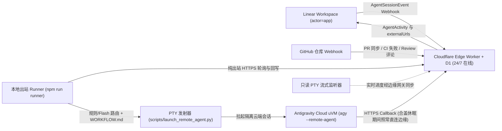

# agy-linear-bridge

[English](README.md) | 简体中文

将 Linear 原生 **Agent Sessions**（`actor=app` 的 `@提及` 或工单指派）桥接到云端隔离的 **Antigravity Remote Agents**（`agy --remote-agent`）。

> [!NOTE]
> **非官方社区集成说明**：本项目基于 Linear `AgentSessionEvent` Webhook / GraphQL API 与 `agy` CLI（已于 `agy 1.5.14`、Node.js `v24.22.1`、Python `3.13.11` 验证）构建。由于当前借助 PTY 自动化与 TUI 状态解析驱动远端会话，后续若上游 `agy` 更新交互输出文案，可能需要同步调整匹配规则。

---

## 架构概览



---

## 核心特性

- **Cloudflare Workers + D1 免费边缘层 + 本地无端口 Runner（推荐架构）**：
  - **Cloudflare 边缘网关 24/7 在线**：托管 OAuth Token 轮换、5 秒内秒回 Linear/GitHub Webhook、10 秒内首发 `thought`，并全天候接收云端 `ACE uVM` 的 Callback。
  - **免配 `cloudflared` 隧道、免域名、本机零入站端口**。
  - **不怕电脑合盖休眠**：云端会话一旦点火，合上电脑后云端 Agent 仍能直连边缘网关更新进度、挂 PR 链接并结单；休眠期间的新工单会自动在 D1 安全入队，开盖后 Runner 自动认领拉起。
  - 同时完整保留 **单进程本地直连模式**（`npm start` + 隧道）。
- **零外部运行时依赖**：本地 Runner 与服务仅依赖 Node.js `>= 22` 内置模块与 Python 3 标准库（`cf` CLI 仅作为构建和部署边缘 Worker 的开发依赖）。
- **零本地 Git worktree 维护**：任务直接在 Antigravity 云端 ACE uVM 中执行，无需在本地维护多仓库 clone 与清理 worktree。
- **符合 Linear Agent 原生协议**：通过 `actor=app` OAuth 授权安装，自动满足 5 秒 Webhook ACK、10 秒内首发 `thought` 与活跃会话生命周期管理。
- **混合多项目路由**：先按确定性规则（`projectId` → `projectSlug` → `projectName` → `labels` → 唯一 `teamKey`）匹配 `config/projects.json`，未命中时可选用无状态 `agy -p` Flash 兜底路由或发 `elicitation` 向人工澄清。
- **对齐 Linear 分支与 Prompt 规范**：自动查询 `issue.branchName`、`priorityLabel`、`parent`、`guidance` 并合并 `promptContext`（避免描述重复注入），确保创建的分支与 PR 自动关联 Linear 工单与状态流转。
- **Per-repo `WORKFLOW.md`（借鉴 Symphony）**：派单前自动从本地路径或 `gh api` 读取仓库根目录 `WORKFLOW.md`（带 TTL 缓存），注入规范正文并支持用 YAML Frontmatter 覆盖 `mode`、`ciAutoFix`、`reviewAutoResume` 与 `maxCiFixRounds`。
- **双向实时反馈与原生态停止**：签名 Callback 协议结合只读 PTY 旁路监听（`watch_remote_agent.py`），支持响应 Linear `stop` 信号立即停监听、锁定后续写回（`409`）并尝试向云端发送 `Esc` 取消（`cancel_remote_agent.py`）。
- **PR 自动挂链与 GitHub CI/Review 闭环（`POST /webhooks/github`）**：自动提取 PR URL 写入 Linear `externalUrls`；配置 GitHub Webhook 后，可在 CI 失败或收到非 Bot Review 时自动 `--conversation` 唤醒原云端会话继续修改（含 SHA 去重与轮次熔断）。

---

## 快速上手

### 前置依赖

- **Node.js `>= 22.0.0`**
- **Python `>= 3.10`**
- **`agy` CLI**（确保本地已完成登录且 `agy --remote-agent` 可正常使用）
- **GitHub CLI（`gh`）**（可选，用于从私有 GitHub 仓库自动读取 `WORKFLOW.md`）
- **`cloudflared`**（或其他能将本地 `127.0.0.1:8787` 暴露为公网 HTTPS 的隧道工具）

### 1. 配置项目路由映射

复制示例配置文件并填入你的 Linear 项目信息与 Antigravity Remote Project 名称或 UUID：

```bash
cp config/projects.example.json config/projects.json
```

在终端启动交互式 `agy --remote-agent` 并执行 `/projects`，即可查看已连接的云端项目列表与 UUID（也可用 `scripts/provision_remote_projects.py` 批量从 GitHub 仓库创建 Remote Project）。

> **提示**：可在 `agy --remote-agent` 内运行 `/config` 检查远端代理的权限预设与计划审批策略，避免长任务无人值守时卡在审批提示。

### 2. 部署模式 A（推荐）：Cloudflare 边缘网关 + D1 + 本地无端口 Runner

无需 `cloudflared` 隧道，本机不监听任何端口：

```bash
npm install
npx cf auth login

# 生成边缘网关与本地 Runner 共享密钥，填入 .env 的 RUNNER_SHARED_SECRET
openssl rand -hex 32

# 一键部署 Worker 并自动创建 D1 数据库
npm run edge:deploy -- --secrets-file .env
```

将部署输出的域名（`https://<name>.<subdomain>.workers.dev` 或通过 `WORKER_CUSTOM_DOMAIN` 绑定的自定义域名）写入 `.env` 的 `PUBLIC_BASE_URL` 与 `EDGE_BASE_URL`，在 Linear OAuth 应用填好回调与 Webhook 地址后访问 `<URL>/oauth/start` 完成一次授权（若本地已有 `data/tokens.json`，也可直接运行 `npm run edge:seed` 无感迁移进 D1）。D1 数据表会在首次请求时自动幂等初始化，无需手动执行 SQL 迁移。

随后在本地或任意常驻 Linux 云主机（如 Oracle Cloud 免费 ARM 实例、1C1G VPS，无需公网入站端口或域名）启动纯出站 Runner 即可：

```bash
# 前台启动（macOS / Linux）：
npm run runner

# 或在 Linux 云主机注册为 24/7 开机自启的 systemd 用户级后台服务：
curl -fsSL https://antigravity.google/cli/install.sh | bash
~/.local/bin/agy   # 完成一次 SSH 远程 Google OAuth 登录授权后 /exit
npm run runner:systemd
```

### 3. 部署模式 B（备选）：单进程本地服务 + 公网 HTTPS 隧道

如果不使用 Cloudflare Workers，也可直接单进程在本地运行：

- **方式 A：Quick Tunnel（零域名，最快联调）**：
  ```bash
  cloudflared tunnel --no-autoupdate --config /dev/null --url http://127.0.0.1:8787
  ```
- **方式 B：固定自定义域名**：
  ```bash
  bash scripts/setup-tunnel.sh bridge.example.com
  cloudflared tunnel --config ./cloudflared.yml run
  ```

启动本地服务并运行交互式安装向导：

```bash
npm start
# 另开终端：
npm run setup:linear
```

### 4. 可选：启用 GitHub CI/Review 自动闭环

1. 在 `.env` 中填入 `GITHUB_WEBHOOK_SECRET` 并重启 `npm start`（`GET /health` 中 `githubWebhookConfigured` 将变为 `true`）。
2. 在 GitHub 仓库或组织 Settings → Webhooks 添加：
   - **Payload URL**：`https://<your-domain>/webhooks/github`
   - **Content type**：`application/json`
   - **Secret**：与 `GITHUB_WEBHOOK_SECRET` 一致
   - **Events**：勾选 `Pull requests`、`Check runs`、`Workflow runs`、`Pull request reviews`、`Pull request review comments`

---

## 仓库级 `WORKFLOW.md` 示例

在目标仓库根目录放置 `WORKFLOW.md`（也可在 `config/projects.json` 中通过 `workflowPath` 或 `localPath` 指定）：

```markdown
---
mode: auto
ciAutoFix: true
reviewAutoResume: true
maxCiFixRounds: 3
---

# 仓库工作流约定

1. 涉及代码修改时，直接使用 Linear 提供的建议分支名。
2. 发起 PR 前在本地/云端环境完整运行 `pnpm test` 与 `pnpm typecheck`。
3. PR 标题必须保留 Linear 工单号。
```

---

## 环境变量说明

完整模板见 [.env.example](.env.example)：

| 变量名 | 默认值 | 说明 |
| :--- | :--- | :--- |
| `PORT` / `HOST` | `8787` / `127.0.0.1` | 本地 HTTP 监听地址 |
| `PUBLIC_BASE_URL` | — | 公网 HTTPS 基址，用于 OAuth、Webhook 与云端 Callback |
| `LINEAR_CLIENT_ID` / `LINEAR_CLIENT_SECRET` / `LINEAR_WEBHOOK_SECRET` | — | Linear OAuth 应用凭据（`actor=app`） |
| `ROUTER_MODE` | `hybrid` | `hybrid`（确定性规则优先 + 无状态 `agy -p` 兜底）或 `rules` |
| `ROUTER_MODEL` | `gemini-3.8-flash-low` | 无状态路由兜底模型 |
| `AGY_REMOTE_MODE` | `accept-edits` | 项目或 `WORKFLOW.md` 未覆盖时的默认执行模式 |
| `WATCHER_ENABLED` | `true` | 是否启用只读 PTY 实时进度监听器 |
| `WORKFLOW_FETCH_ENABLED` | `true` | 是否启用 `WORKFLOW.md` 加载与缓存（`WORKFLOW_CACHE_TTL_MS=300000`） |
| `GITHUB_WEBHOOK_SECRET` | — | `POST /webhooks/github` 的 HMAC-SHA256 签名密钥 |
| `GITHUB_CI_AUTO_FIX` / `GITHUB_REVIEW_AUTO_RESUME` | `true` | 是否在 CI 失败或 PR Review 时自动唤醒会话 |
| `GITHUB_MAX_CI_FIX_ROUNDS` | `3` | 单会话连续自动修 CI 的上限次数，超出后转为 Linear `elicitation` |
| `GITHUB_IGNORED_ACTORS` | — | Review Webhook 需额外忽略的 GitHub 用户名（逗号分隔） |

---

## 常用校验与排障命令

```bash
# 运行全部单元测试与集成测试
npm test

# 测试工单路由决策（不会实际拉起云端会话）
npm run route-test -- --team ENG --project backend-app --title "Fix webhook timeout"

# 校验 Linear actor=app Token 身份
npm run verify-identity

# 查看运行状态与当前活跃 watcher 数量
curl http://127.0.0.1:8787/health
```

---

## 开源协议

[MIT](LICENSE)
